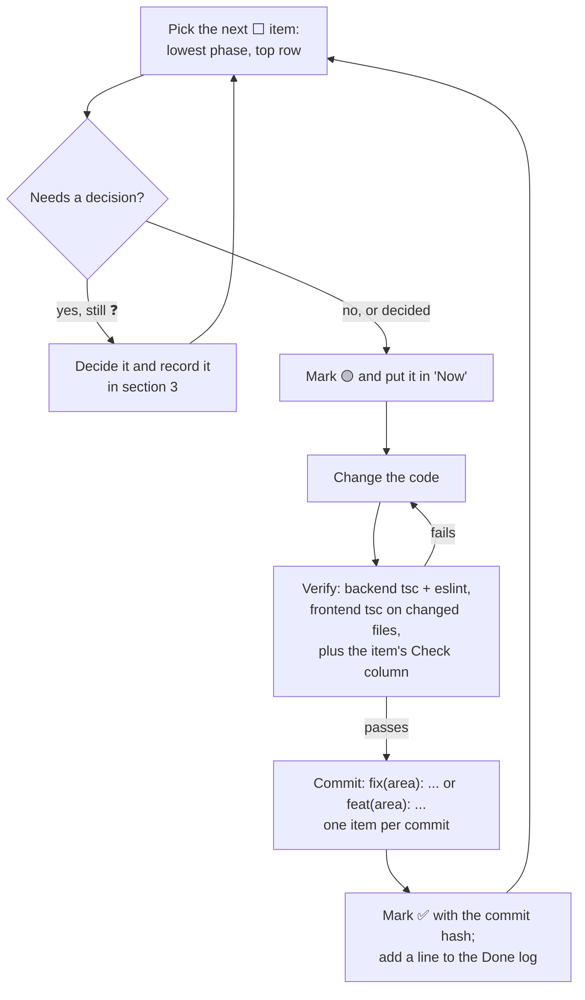

# Fix Plan and Tracker

This is the living list of what we are fixing, in order: what is done, what is in progress, and what needs a decision first. Update it after every fix. A commit can't contain its own hash, so the ✅ and the hash are written right after the commit and committed with the next item, or in a `docs(plan)` commit.

- The details behind each issue are in [roles-products-stock.md](roles-products-stock.md) and [hard-coded-values.md](hard-coded-values.md).
- Older review findings are in [review/](review/README.md).
- Last updated: **2026-11-12**.

**Status key**

| Mark | Meaning |
|---|---|
| ⬜ | To do |
| 🟡 | In progress |
| ✅ | Done |
| 🟠 | Partly done |
| ❓ | Waiting for a decision |
| ⛔ | Blocked |
| ➖ | Won't do |

---

## 1. Now

| | |
|---|---|
| **Branch** | Phase 0: `fix/p0-quick-fixes`. Phase 1: `fix/p1-stock-and-store` (from `fix/p0-quick-fixes`). Not pushed. |
| **Doing now** | Phase 1, in five lanes that touch different files, one item at a time per lane: A) P1-01 → P1-05 → P1-06 (products), B) P1-07 → P1-03 → P1-02 (stock), C) P1-04 → P1-10 (store), D) P1-13 → P1-11 (customers, uploads), E) P1-09 → P1-08 → P1-12 (fake data on screens). Every item is reviewed and committed on its own. |
| **Your work in progress (W-01)** | POS bill types (B2C/B2B tax invoice, retail invoice), buyer GSTIN, salesman on the bill, payment reference, printed sales invoice (`salesBillInvoice.ts`). Also your fix to `seedDemo.ts` (reuse existing sizes and colours; the seed broke after the standard sizes in 87dbd57). Uncommitted, and left out of every commit on this branch. P0-05 and P0-08 changed a few lines in `bill.service.ts` and `NewBillPOSPage.tsx`; only those lines were committed, so your copy has both. **Commit it before Phase 4**, which touches the same files. |
| **Your work in progress (W-02)** | Single-shop mode with the upgrade to branch mode (D-17), which also covers P3-06. Backend: `Company.businessMode` with migration `20261113090000_company_business_mode` (already applied locally), `company.*`, `shop.service.ts` (refuses a second shop), `org.controller.ts` (refuses a branch; `POST /company-admin/branch-mode`), `user.service.ts` (`/users/me` has `company.businessMode`), `dayClose.*`, `shopAdmin.routes.ts` and `ownerShop.ts` (owner routes). Frontend: `roles.ts`, `AppLayout`, `Sidebar`, `MyCompany`, `CompanyForm`, `ShopList`, `ScopedDashboard`, `CashBookPage`, `StaffRightsPage`, `StockTransferPage`, the branch day-close and transfer pages, and the new `components/DayClose` and `components/StockTransfer`. Uncommitted; **leave it out of Phase 1 commits**. |
| **Next up** | 1) P0-13, your step: run `npm run seed:demo -- --remove` on each shared server. 2) Phase 2. 3) Commit W-01 before Phase 4. |

---

## 2. How we work (the flow)

**Rules**
1. **One item per commit.** The commit message names the item, e.g. `fix(pos): no default PIN (P0-01)`.
2. **Decide first.** An item marked ❓ is not started until its decision is in §3 under Decided.
3. **New problems go to the Inbox (§6).** They are not fixed inside another item's commit.
4. **Split big items.** If an item grows, split it (P1-02a, P1-02b) and mark each one separately.
5. **Commits.** Split by feat/fix, with no Co-Authored-By lines (decision D-D). Push only when asked.

---

## 3. Decisions

### Open

None right now. Add new questions here with ❓.

| ID | Question | Options (★ = recommended) | Blocks | Status |
|---|---|---|---|---|
| | | | | |

### Decided

| ID | Decision | Date | Affects / commit |
|---|---|---|---|
| D-01 | Company and branch panels keep "Add product", but must pick the shop the product belongs to. Products with no shop are shown as "Not in any shop" | 2026-11-12 | P3-01 |
| D-02 | **Sizes and colours belong to each shop.** A new shop gets a copy of the standard sizes and colours, then edits its own; that never changes another shop. A new size or colour can be added straight from the product form's dropdown. **Categories and sub-categories stay one company-wide list** (edited in the company panel; to confirm). Needs `shopId` on `Size` and `Color` (today they belong to the company) | 2026-11-12 | P3-02, P3-10, I-08 |
| D-03 | Online orders are handled by the selling shop; branch, company and super admin only view them | 2026-11-12 | P3-03 |
| D-04 | Replace the fake "Stock Quantity" with a real "Opening stock" that records a stock movement | 2026-11-12 | P1-01 (takes in I-03) |
| D-05 | GST is a setting per shop: each shop sets its slabs and price rule (for example 5% up to ₹2,500 a piece, 18% above). The POS applies it and the server checks it. Each shop confirms its numbers with its own CA | 2026-11-12 | P4-01, P4-02 |
| D-06 | A product copied into a shop by a stock transfer starts as DRAFT; the shop publishes it | 2026-11-12 | P1-06 |
| D-07 | Remove the demo company everywhere except local dev (`npm run seed:demo -- --remove`) | 2026-11-12 | P0-13 |
| D-08 | `/shop-admin` is only for shop admins and the company admin in shop mode (employees use `/employee`). The super admin and branch admins are refused | 2026-11-12 | P2-01 |
| D-09 | An unpaid online order cancels itself and frees its stock after 30 minutes | 2026-11-12 | P5-02 |
| D-10 | Labels use Code128 barcodes (`jsbarcode`) | 2026-11-12 | P5-06 |
| D-11 | Online refunds go through the Razorpay refund API, and the refund id is stored on the order | 2026-11-12 | P5-01 |
| D-12 | Server time zone is India (`Asia/Kolkata`) | 2026-11-12 | P0-08 |
| D-13 | The branch "Products & Prices" page is view only; prices are set by the shop | 2026-11-12 | P3-04 |
| D-14 | Leave the hidden character in commit ae168b8's message (no force-push) | 2026-11-12 | O-01 |
| D-15 | Prisma migrations stay out of git. After a schema change, each server creates and applies its own migration, so check that `schema.prisma` and the database match after every pull | 2026-11-12 | O-02, P4-04, P4-08, P5-09, D-02 |
| D-16 | An employee may ask to delete a confirmed bill; the shop admin or owner approves it first | 2026-11-12 | P2-03 |
| D-17 | **Business type per company: Single shop or Shops & branches** (`Company.businessMode`, default Shops & branches). The super admin picks it; a single-shop owner lands in their shop, sees no branch screens, and can't add a second shop or a branch until they press "Switch to branch mode" in Company Profile (one way; the super admin can set it back while there is only one shop and branch). In shop mode the owner can also accept day-close differences and approve stock transfers (takes in P3-06) | 2026-11-12 | W-02 |
| D-A | A company admin runs a shop in "shop mode": the shop is picked per browser tab, sent as `X-Shop-Id`, and they act as that shop's admin | 2026-11-10 | 340d795 |
| D-B | A company with no branches gets an automatic "Main Branch" from the company address | 2026-11-10 | 44748d8 |
| D-C | Refunds the owner takes are approved at once; the owner approves staff refunds | 2026-11-10 | 340d795 |
| D-D | Commits are split by feat/fix, with no Co-Authored-By lines | 2026-11-09 | – |
| D-E | AI photos: up to 3 Cloudflare accounts, tried in order when one is used up or fails | 2026-11-09 | 0609205 |

---

## 4. Issues, one by one

### Phase 0: quick and safe (no decision needed, small changes)

| ID | Problem | Fix | Where | Check | Needs | Status |
|---|---|---|---|---|---|---|
| P0-01 | Users without a PIN get PIN 1234 when they save their profile | Empty by default; send only when typed | `frontend/src/pages/profile/MyProfilePage.tsx:30, 87` | Save the profile without a PIN; the DB PIN is unchanged | – | ✅ ea7800a |
| P0-02 | Barcode labels print "MATOSHRI FASHIONS" | Use the logged-in shop's name | `frontend/src/pages/shop/barcode/BarcodeLabelsPage.tsx:361, 811` | Print preview shows your shop | – | ✅ 654bfe7 |
| P0-03 | Customer is told "₹X has been refunded" when no refund was made | Change the text to "Refund approved; you'll get it within N days" | `backend/src/services/order.service.ts:578-585, 651, 863` | Set an order to REFUNDED; read the notification | – | ✅ 2589204 |
| P0-04 | Debit note defaults to the fake supplier "Tiruppur Knits - 33" and a fake bill | Start empty; set from the loaded suppliers; remove the fake options | `frontend/src/pages/shop/returns/PurchaseReturnPage.tsx:37, 250, 272` | Save a debit note; the supplier is the real one | – | ✅ 93167b3 |
| P0-05 | Every new POS bill shows "…/26-27/00232" | Show "New bill" or the real next number | `frontend/src/pages/shop/pos/NewBillPOSPage.tsx:738` | Open the POS | W-01 (committed on its own, without W-01) | ✅ 0714207 |
| P0-06 | CORS lets any website call the API | Use `config.cors.origins`; set `CORS_ORIGINS` for both frontends | `backend/src/app.ts:36`, `backend/.env` | Panel and store still work; another origin is refused | – | ✅ 32a6886 |
| P0-07 | Public test page with a dev-tunnel URL | Delete the file | `backend/public/backup-test.html` | `/backup-test.html` returns 404 | – | ✅ 14901ec |
| P0-08 | Bills between 00:00 and 05:29 IST can get yesterday's date | a) Server: `TZ` in config, default `Asia/Kolkata`, a wrong name is refused at startup; six number series and day checks use `dayKey` instead of the UTC day. b) Screens: date fields default to the local day (`date-fns` `format`) | `config/config.ts`, `.env.example`, `bill`, `creditNote`, `shop`, `stockAdjustment`, `store/account`, `store/checkout` services; `BillFormModal`, Credit/Udhaar, Purchase Return, Suppliers, Customer Dues, POS due date, store profile | 01:30 IST counts as the new day and the new financial year (tested) | D-12 | ✅ 754ad4a, 1c17df3 |
| P0-09 | My Profile shows the company admin as "Branch Manager"; the header "My Profile" link gives "Access denied" for the company admin, super admin and employees | Use the `ROLES` labels; profile path per panel | `MyProfilePage.tsx:39-46`, `Header/DropdownUser.tsx:31-34` | Open My Profile as each role | – | ✅ 47cff00 |
| P0-10 | Debit note adds 5% GST to 0% items | `??` instead of `\|\|`; take the rate from the purchase bill line | `backend/src/services/purchaseReturn.service.ts:129, 203, 265`, `validations/purchaseReturn.validation.ts:14` | Return a 0% item; tax is 0 | – | ✅ 9146ef6 |
| P0-11 | Fake number series: debit notes start at 0004, receipts at 0044 | Use `accountService.nextCode` with no offset | `purchaseReturn.service.ts:46`, `credit.service.ts:59` | First new number is 0001 in a fresh FY | – | ✅ 9d1d409 |
| P0-12 | Credit/Udhaar page: fake totals, picks "Kavita", ₹2,000 default, `RC/26-27/0044` | `?? 0` / "—"; first customer; empty amount | `frontend/src/pages/shop/credit/CreditUdhaarPage.tsx`, `lib/api/credit.ts:35` | Page with no customers shows zeros | – | ✅ 1746dc5 |
| P0-13 | Demo company's products show on the store | Run `npm run seed:demo -- --remove` on shared environments | (ops step) | The store shows only real shops | D-07 | ⬜ your step |

### Phase 1: wrong numbers and wrong products online

| ID | Problem | Fix | Where | Check | Needs | Status |
|---|---|---|---|---|---|---|
| P1-01 | Shop product "Stock Quantity" is fake; the panel and the store disagree | Per D-04: replace the field with "Opening stock" that records a stock movement through `applyStockChanges`; show real stock from `Inventory` | `shopProduct.validation.ts:64`, `shopProduct.service.ts`, `shopProductSchema.ts:39`, `ShopProductForm.tsx`, `ShopProductList.tsx:151-154`, `ShopProductDetail.tsx` | Opening stock shows in the stock movements; the panel, POS and store show the same number | D-04 | ✅ e1f2624 |
| P1-02 | Stock page shows hard-coded totals, rows, costs and "This month (1-3 Nov)"; the date filter does nothing; lists every company product | Compute from `Inventory` and movements; filter by date; only the shop's own items | `backend/src/services/stock.service.ts`, `frontend/src/pages/shop/stock/StockPage.tsx` | Totals match a manual sum; another shop's items are not listed | – | 🟡 |
| P1-03 | Stock Adjustment: fake ADJ-0046 numbering, ids clash between branches, no transaction, fake "before" counts | `nextCode`; unique id; one transaction through `applyStockChanges`; no fallbacks | `stockAdjustment.service.ts`, `StockAdjustmentPage.tsx`, `lib/api/stockAdjustment.ts:18` | Two branches can each make an adjustment | – | ✅ 30e3dde |
| P1-04 | Store shows products of switched-off branches; wishlist and bag check less than the listing | One shared `LISTED` rule with the branch check, used for listing, detail, cart add, bag line and wishlist | `store/catalog.service.ts:56-61`, `store/customer.service.ts:93, 221-239, 341, 350` | Deactivate a branch: its products disappear and can't be ordered | – | ✅ 6bd03c2 |
| P1-05 | Renaming a product breaks its link | Keep the slug from creation | `shopProduct.service.ts:348`, `product.service.ts:226` | Rename; the old URL still opens | – | ✅ fed3332 |
| P1-06 | Received transfers create published copies online | Create the copy as DRAFT | `stockTransfer.service.ts:526-544` | Receive a new item; it isn't on the store until published | D-06 | ✅ 5a542ff |
| P1-07 | A shop can change another shop's stock in the same company (other companies were blocked in 7caed27) | Only allow `product.shopId = own shop` in all 3 adjust paths | `inventory.service.ts:225-230`, `stock.service.ts:366-369`, `stockAdjustment.service.ts:212-214` | Adjusting shop B's variant from shop A → 403 | – | ✅ 4222f3f |
| P1-08 | Suppliers page: picks "Tiruppur", `PY/26-27/0019`, fixed statement period | Remove; use real data and dates | `frontend/src/pages/shop/suppliers/SuppliersPage.tsx:82-96`, `lib/api/supplier.ts:32` | Page with no suppliers shows an empty state | – | ✅ 509030a |
| P1-09 | Debit note prefilled note, quantities and reason ("Ivory"), ₹18,900, `DN/26-27/0006` | Delete the prefills and fallbacks | `PurchaseReturnPage.tsx:46, 86-97, 144, 223`, `lib/api/purchaseReturn.ts:18` | Form starts empty | – | ✅ 1b2502d |
| P1-10 | Open store tabs show sold-out or unpublished items; out-of-stock items lead "New arrivals" | Refetch on focus for home, listing and search; in-stock first in two queries | `user/src/main.tsx:11`, `user/src/lib/queries.ts`, `store/catalog.service.ts:502, 527` | Unpublish, return to the tab: the item is gone | – | ✅ cba681d |
| P1-11 | Profile photo and expense bill save only the file name | Upload through the existing file endpoint | `MyProfilePage.tsx:88`, `ShopExpensesPage.tsx:109` | The photo shows after reload | – | ✅ 7cd13b5 |
| P1-12 | Barcode page: picks bill "0042"; prints the sample "Cotton Kurta Indigo" when empty | Empty state instead | `BarcodeLabelsPage.tsx:110-115, 219-232` | No bills → nothing to print | – | ✅ 831104d |
| P1-13 | A new customer always gets 15 credit days: the customer API's create rule has no `creditDays` (it is dropped) and customers made from a bill don't pass it, so the database default wins | Accept and save `creditDays` on create and edit; `syncCustomerFromBill` takes the bill's credit days when it creates a customer (your bill work must pass them; the bill's credit days exist only in W-01) | `validations/customer.validation.ts:14`, `services/customer.service.ts:110`, `services/customerLedger.ts:70` | Create a customer with 30 days; it shows 30 | – | ✅ b00e75a |

### Phase 2: security and who-sees-what

| ID | Problem | Fix | Where | Check | Needs | Status |
|---|---|---|---|---|---|---|
| P2-01 | `/shop-admin` also accepts the super admin (sees and changes all orders, all employees, any stock) and the branch admin (edits company masters) | Allow only shop admins and the company admin in shop mode; first check branch pages that call it | `backend/src/routes/shopAdmin.routes.ts:178` | Super admin token on `/shop-admin/orders` → 403 | D-08 | ⬜ |
| P2-02 | A shop sees other shops' suppliers and purchase bills, barcode-label bills and Stock page items | Filter by `shopId` | `supplier.service.ts:39-45, 272-279`, `barcodeLabel.service.ts:23-26, 109-110`, `stock.service.ts:145` | Shop A can't see shop B's bills | – | ⬜ |
| P2-03 | An employee with billing edit can delete a confirmed bill without approval | Per D-16 | `bill.routes.ts:20`, `bill.service.ts:1036-1054` | Employee delete → 403 (or approval) | D-16 | ⬜ |
| P2-04 | Branch product edit rights follow the creator's current branch | Use the product's shop's branch | `product.service.ts:22, 58` | Move an employee; product rights stay | – | ⬜ |
| P2-05 | `HOSTED_BACKEND_URL` silently defaults to an external upload server | Add to the config schema, no default | `backend/src/utils/s3upload.ts:5`, `config/config.ts` | Unset → clear error at startup | – | ⬜ |
| P2-06 | `posPin` returned in user data and not hashed; password rules; `/refresh` rate limit; refresh tokens not hashed (older review) | Hash and stop returning the PIN; rules; limit; hash tokens | `user.service.ts:42`, `auth.*` | See `review/06-authn-payments-audit.md` | – | ⬜ |
| P2-07 | `mustChangePassword` is never enforced in the admin app (older review) | Send to a change-password page after login | `frontend` auth flow | First login forces a change | – | ⬜ |
| P2-08 | XSS cleaning is off (TODO) | Turn it on, or remove it and rely on output escaping | `backend/src/app.ts:28-29` | – | – | ⬜ |
| P2-09 | 20 controllers write without an audit entry; Main Branch creation not audited | Add `auditService.track` | orders, stock, promotions, suppliers, pricing, expenses, credit limit, branch | Each write shows in the audit table | – | ⬜ |
| P2-10 | Admin panel falls back to `localhost:5692` when `VITE_SERVER_URL` is missing | Fail the build | `frontend/src/utils/axios.ts:8, 12` | Build without the variable fails | – | ⬜ |
| P2-11 | A debit note trusts the unit cost sent by the browser | Take the unit cost from the purchase bill line, like the GST rate (P0-10) | `purchaseReturn.service.ts` `createPurchaseReturn` | Tamper the cost in the request → ignored | – | ⬜ |
| P2-12 | With `CORS_ORIGINS` empty, any origin is allowed again | Refuse to start in production without it | `backend/src/app.ts`, `config/config.ts` | Production start without it fails with a clear message | – | ⬜ |

### Phase 3: make roles and stock clear

| ID | Problem | Fix | Where | Check | Needs | Status |
|---|---|---|---|---|---|---|
| P3-01 | Company and branch create products that can never be sold | Per D-01: a required shop picker; show existing ones as "Not in any shop" | `product.service.ts:150-205`, company and branch product pages, `Sidebar:177` | No unsellable product can be created | D-01 | ⬜ |
| P3-02 | Categories, sizes and colours are edited in a shop but apply company-wide | Per D-02: sizes and colours per shop (a new shop gets the standard list; add from the product form); categories stay company-wide | `master.service.ts:20-27`, `shopAdmin.routes.ts:45-59`, menus | A shop can't rename "XL" for everyone | D-02 | ⬜ |
| P3-03 | Online orders can be changed at four levels | Per D-03 | order routes in the company, branch and shop routers | Only the owner level sees action buttons | D-03 | ⬜ |
| P3-04 | Prices set in three places | Shop only; branch page per D-13 | `branchPricing.service.ts`, `product.service.ts` | – | D-13 | ⬜ |
| P3-05 | Three stock-adjust code paths | Merge into one path through `applyStockChanges` | `inventory.service.ts`, `stock.service.ts`, `stockAdjustment.service.ts` | Concurrent sale + adjust: no lost update | P1-03, P1-07 | ⬜ |
| P3-06 | The company admin can't approve stock transfers; Main Branch requests get stuck | Owner approves when there is no branch admin (shop mode, like refunds) | `stockTransfer.service.ts`, `shopAdmin.routes.ts`, transfer page | Request in Main Branch → owner approves | – | 🔧 in W-02 (D-17) |
| P3-07 | Menu text promises missing features; branch "Purchase Return" always fails; pages with no menu entry | Fix the wording; hide or route correctly | `Sidebar/index.tsx:218, 237, 289, 309, 521`, `PurchaseReturnPage.tsx:24` | Every menu item opens and works | – | ⬜ |
| P3-08 | Four staff-onboarding paths; the branch invite shows 10 modules but saves 6 | One path; one module list | `staff.service.ts:224`, `config/permissions.ts:124-131`, `BranchStaffPage.tsx:15` | Ticked modules are saved | – | ⬜ |
| P3-09 | Two branch refund-approval endpoints, one not audited | Keep the audited one | `branchAdmin.routes.ts:134, 159` | – | – | ⬜ |
| P3-10 | Renaming a size or colour, then saving a product, switches off variants and their stock | Match variants by master id, not name | `shopProduct.service.ts:215-248` | Rename "XL"; stock stays | – | ⬜ |

### Phase 4: tax, documents and settings

| ID | Problem | Fix | Where | Check | Needs | Status |
|---|---|---|---|---|---|---|
| P4-01 | GST slab lists are 0/5/12/18 | Per D-05: GST slabs and price rule set per shop | validations, product forms, `BillFormModal.tsx:42` | – | D-05, W-01 | ⛔ W-01 |
| P4-02 | The POS sends the GST rate and the server trusts it | Server applies the shop's GST rule (D-05), not the rate the POS sends | `bill.service.ts:338, 431`, `bill.validation.ts:25`, `NewBillPOSPage.tsx:295` | Tamper the rate in the request → ignored | D-05, W-01 | ⛔ W-01 |
| P4-03 | GST maths copied in 4+ places; IGST chosen by state name | Backend returns the GST breakup by state code; UIs print it | POS, `BillFormModal`, `salesBillInvoice.ts`, `user/src/routes/invoice.$id.tsx` | Screen, receipt and invoice match to the paisa | W-01 | ⬜ |
| P4-04 | HSN missing on products; fallbacks 6206 and 6204 (the POS shows "6204" on every line) | Add HSN to the product (migration); require it | `schema.prisma`, product forms, `purchaseReturn.service.ts:116`, `NewBillPOSPage.tsx:285` | Debit note and bill show the product's HSN | D-15 | ⬜ |
| P4-05 | Financial-year helper copied 4 times; `AUD-26-27` typed in | One helper | `bill.service.ts:74`, `expense.service.ts:20`, `credit.service.ts:39`, `purchaseReturn.service.ts:26`, `stock.service.ts:464` | – | – | ⬜ |
| P4-06 | Bill numbers can exceed 16 characters (GST limit, verify) | Limit the prefix; configurable series | `bill.service.ts:166`, `org.validation.ts:119` | – | – | ⬜ |
| P4-07 | Online-order invoice: no seller GSTIN or HSN, two invoice numbers, fake tagline | Backend issues one number; print GSTIN, HSN and breakup | `frontend/src/utils/invoiceGenerator.ts`, `user/src/routes/invoice.$id.tsx` | Same number in the panel and the store | – | ⬜ |
| P4-08 | Business rules fixed in code: refund limit ₹2,000, 10% discount, low stock 5/3, delivery ₹49/₹999/₹99, ETAs, 7-day returns, credit days 15, margin 25%, shift times | One company-settings record; UIs read it | see `hard-coded-values.md` §3 | Change a setting → screens follow | D-15 | ⬜ |
| P4-09 | Store address form has 22 of 36 states; one size chart for all; menu categories exist only in demo data | Full state list; size chart per category or hidden; menu from real categories | `user/src/components/AddressForm.tsx`, `product.$id.tsx:15-22`, `index.tsx:37`, `Layout.tsx:16-18` | A Ladakh address saves | – | ⬜ |
| P4-10 | "Cloth Pro" printed on invoices and WhatsApp; page title typo | App name setting; documents use the shop name | see `hard-coded-values.md` §4 | – | – | ⬜ |
| P4-11 | Row caps hide data (2,000 products, 50 orders, exports 5,000/1,000, …) | Paginate or warn | see `hard-coded-values.md` §3 | – | – | ⬜ |

### Phase 5: online orders, money and stock accuracy

| ID | Problem | Fix | Where | Needs | Status |
|---|---|---|---|---|---|
| P5-01 | No real online refunds | Per D-11 | `order.service.ts` | D-11 | ⬜ |
| P5-02 | Unpaid online orders hold stock forever | Job that cancels and restocks after the expiry time | `store/checkout.service.ts`, `order.service.ts:355-386` | D-09 | ⬜ |
| P5-03 | Cancel after dispatch restocks goods at the courier; exchanges never take the new size out of stock | Block restock after dispatch; post SALE_OUT for the exchange | `order.service.ts:595-622, 794, 862` | – | ⬜ |
| P5-04 | Purchase return: "take stock from" ignored, no movement, shop id saved as branch id (so a note without a purchase bill never lowers stock), bill can be cancelled after a debit note | Route through `applyStockChanges`; fix branch; block cancel | `purchaseReturn.service.ts:237-291`, `bill.service.ts:608-716` | – | ⬜ |
| P5-05 | Damaged returns and transfer shortages vanish from all counts | Record `damagedQty` and a movement | `creditNote.service.ts:302`, `stockTransfer.service.ts:619` | – | ⬜ |
| P5-06 | Barcode bars are decorative and won't scan | Real barcodes | `BarcodeLabelsPage.tsx:46-74, 370-378` | D-10 | ⬜ |
| P5-07 | Delivery estimate is the same for every pincode; COD always yes | Courier data, or say "usually" | `store/catalog.service.ts:537-553`, `store/orders.service.ts:161` | – | ⬜ |
| P5-08 | Day close has no cash count; bills can be changed after close (older review) | Cash count; lock closed days | day close and bill services | – | ⬜ |
| P5-09 | Money stored as Float; no double-submit guard on bills (older review) | Decimal; idempotency key | `schema.prisma`, POS | D-15 | ⬜ |
| P5-10 | Receipt and debit note numbers are picked outside the save; two at once can get the same receipt number (no unique index) | Pick inside the transaction with `withRetry`; unique index on receipts | `credit.service.ts:389`, `purchaseReturn.service.ts`, `schema.prisma` | – | ⬜ |

### Phase 6: clean-up and health

| ID | Problem | Fix | Status |
|---|---|---|---|
| P6-01 | 190 catering-app files and dead pages (`BranchSuppliersPage`, `BranchDashboard`, `ComingSoon`, `BranchProfile`, `Calendar`, `ExpiryPopup`, `ModalComponent`, `TabularContent`) | Delete; check with a build | ⬜ |
| P6-02 | Unused permissions; leftover constants (`s3constants.ts`, `constants.ts`, `link-to-app`); fake actor ids (`'user-admin'`, `'admin'`, `'system'`) | Delete or use `req.user.id` | ⬜ |
| P6-03 | `package.json` name "restaurant", broken `prisma:db:seed`; swagger empty in builds and public | Fix or turn off in production | ⬜ |
| P6-04 | No tests or CI | Tests for billing, stock and credit first; CI runs tsc, lint and tests | ⬜ |

### Older open items

| ID | Item | Needs | Status |
|---|---|---|---|
| O-01 | Hidden character at the start of commit ae168b8's message | D-14 | ➖ |
| O-02 | Prisma migrations are not in git | D-15 | ➖ |

---

## 5. Improvements (new features)

| ID | Improvement | Why | Needs | Status |
|---|---|---|---|---|
| I-01 | Company sales and P&L report | The owner has only counts today | – | ⬜ |
| I-02 | Audit log page | Audit rows are written but nobody can read them | P2-09 | ⬜ |
| I-03 | Opening stock when adding a product | Faster set-up for a new shop | D-04 = b | ➖ part of P1-01 |
| I-04 | Company settings page | Owners change limits, fees and number series themselves | P4-08 | ⬜ |
| I-05 | Owner approvals inbox (refunds and transfers in one place) | Small businesses with no branch admin | P3-06 | ⬜ |
| I-06 | Courier tracking and real delivery dates | Honest delivery promises | P5-07 | ⬜ |
| I-07 | Product drafts: a half-filled new product is kept; when the user comes back, they pick "Start new" or "Resume" | Long product forms are not lost | – | ⬜ |
| I-08 | Add a new size or colour from the product form's dropdown | No trip to the masters page | D-02 | ⬜ |

More ideas: GST exports, loyalty, WhatsApp, offline POS. See [review/04-feature-roadmap.md](review/04-feature-roadmap.md).

---

## 6. Inbox (new problems, not yet sorted)

Add new findings here with ⬜. Sort them into a phase when the next item is picked.

| Found | Problem | Where | Status |
|---|---|---|---|
| 2026-11-12 (P0-10) | The debit note still trusts the unit cost sent by the browser; it should come from the purchase bill line, like the GST rate now does | `purchaseReturn.service.ts` `createPurchaseReturn` | → P2-11 |
| 2026-11-12 (P0-11) | Receipt and debit note numbers are picked before the save, outside a transaction. Two saves at once can get the same receipt number, because receipts have no unique index | `credit.service.ts:389`, `purchaseReturn.service.ts`, `schema.prisma` (CustomerCreditPayment) | → P5-10 |
| 2026-11-12 (you) | POS heading always showed …/26-27/00232 while real bills were 00001 to 00004 | `NewBillPOSPage.tsx` | ✅ P0-05 |
| 2026-11-12 (you) | A new customer always gets 15 credit days. The customer API's create rule has no `creditDays` (so it is dropped), and customers created from a bill don't pass it; the database default 15 wins | `validations/customer.validation.ts:14`, `services/customer.service.ts:110`, `services/customerLedger.ts:70` | → P1-13 |
| 2026-11-12 (you) | HSN column shows "6204" for every item | POS | → P4-04 |
| 2026-11-12 (you) | Bill type stays on B2B after a B2B bill is saved | your bill-type work (W-01) | ⬜ W-01 |
| 2026-11-12 (P1-13) | So a customer made from a bill gets the bill's credit days, your bill work needs to: add `creditDays` (int 0-365, optional) to `salesFields` in `bill.validation.ts`; in `bill.service.ts` take `creditDays` out of the header in `createSales` and `updateSales` (SalesBill has no such column) and pass it as `syncCustomerFromBill(tx, before, {...bill, creditDays})`; send `creditDays` from the POS when there is credit (`BillPayload` in `types/bill.ts`). `CustomerPage.tsx` needs a "Credit days" input (send `undefined` when empty, or it saves 0); the POS new-customer modal can send it too. A draft confirmed later still gets 15 | `bill.validation.ts`, `bill.service.ts`, `NewBillPOSPage.tsx`, `types/bill.ts`, `CustomerPage.tsx` | ⬜ W-01 |
| 2026-11-12 (you) | Demo seed broke after the standard sizes and colours (87dbd57) | `seedDemo.ts` | ✅ fixed by you, in W-01 |
| 2026-11-12 (P1-11) | Stock adjustment saves its photo as a base64 data URL, but the API caps `photoUrl` at 500 characters, so an adjustment with a real photo is refused | `StockAdjustmentPage.tsx:118-128`, `validations/stockAdjustment.validation.ts:19` | → P1-03 |
| 2026-11-12 (P1-11) | Staff have no upload endpoint (the only general one, `/store/uploads`, is customers-only; the others are per record and allow SVG). P1-11 adds `POST /users/uploads` for staff roles: JPG/PNG/WEBP, 5 MB | `routes/user.routes.ts`, `utils/fileStore.ts` | → P1-11 |
| 2026-11-12 (P1-10) | Store app type-check fails on an old line: `navigate({href: n.link})` (`href` is not a navigate option) | `user/src/routes/account/notifications.tsx:54` | ⬜ |
| 2026-11-12 (seen while reviewing) | Work outside this plan is going on in the same folder: a "single shop" business mode (`businessMode`), day-close screens, and the owner approving stock transfers in shop mode (that is P3-06). It is not part of any Phase 1 commit | `roles.ts`, `company.*`, `dayClose.*`, `shopAdmin.routes.ts`, `ownerShop.ts` and others | ✋ yes, a separate session's work (D-17, W-02). Leave these files out of Phase 1 commits |
| 2026-11-12 (P1-08) | Supplier statement covers the whole ledger; the period label is built from the first and last entry and shows only the last year. A real month or financial-year statement needs from/to dates on the ledger endpoint | `supplier.service.ts` `getSupplierLedger` | ⬜ |
| 2026-11-12 (P1-08) | With no suppliers, the "Make payment" form is still shown and Save silently does nothing | `SuppliersPage.tsx` | ⬜ |
| 2026-11-12 (P1-01) | `Product.stockQuantity` is now only a cache that nothing shows; the manual adjust paths and purchase returns don't update it. Drop the column later | `schema.prisma`, `stock.service.ts`, `stockAdjustment.service.ts`, `purchaseReturn.service.ts` | → P3-05 |
| 2026-11-12 (P1-01) | `roles-products-stock.md` §4.2-4.3 still describe the fake "Stock Quantity" | `docs/roles-products-stock.md` | ⬜ |
| 2026-11-12 (P1-12) | Barcode print window always uses a 50×30 mm page whatever label size is chosen; the printer list doesn't reach a real printer (browser print dialog) | `BarcodeLabelsPage.tsx` | → P5-06 |
| 2026-11-12 (P1-11) | An upload over 5 MB returns 500 "File too large" (multer errors become 500); should be 400 | `middlewares/error.middleware.ts` | ⬜ |
| 2026-11-12 (P1-11) | Expense bills can no longer be PDFs (the photo route takes images only) | `ShopExpensesPage.tsx`, `routes/user.routes.ts` | ⬜ |
| 2026-11-12 (P1-11) | `CurrentUser` type has no `photoUrl` or `posPin`; the header avatar doesn't show the profile photo | `hooks/useCurrentUser.ts`, `Header/DropdownUser.tsx` | ⬜ |
| 2026-11-12 (P1-03) | Stock adjustment leftovers: approval status is never pending (AUTO / APPROVED with no approver); the user's notes are replaced by "Logged by…"; picker search does nothing and shows only 50 items; "Lost / theft" filter not handled; branch falls back to the company's first branch; controller uses actor `'system'`; the page preselects "Mark damaged" / "Stitching defect"; photo labelled required but not enforced; notes state has no input | `stockAdjustment.service.ts`, `stockAdjustment.controller.ts:36`, `StockAdjustmentPage.tsx` | ⬜ |
| 2026-11-12 (P1-03) | Adjustment numbers have only a plain index; a unique index `(branchId, adjustmentNumber)` would make the per-branch lock a database guarantee | `schema.prisma` | → P5-10 |
| 2026-11-12 (P1-06) | Transfer copies get no slug (store links fall back to the id), and since P1-05 updates never set one; give the copy a slug when it is created | `stockTransfer.service.ts` `cloneIntoShop` | ⬜ |
| 2026-11-12 (P1-06) | The POS sells draft products (its item picker ignores status), so a shop can sell received stock before publishing the copy. Probably right for in-shop items; confirm | POS item search | ❓ |
| 2026-11-12 (branch vs shop check) | A debit note without a purchase bill saves the shop's id as its branch id, then looks for stock under that wrong id, so stock never goes down. It is part of P5-04; move P5-04 up | `purchaseReturn.service.ts:239, 278` | → P5-04 |
| 2026-11-12 (P0-06) | If `CORS_ORIGINS` is empty, any origin is allowed again. The server should refuse to start in production without it | `backend/src/app.ts`, `config/config.ts` | → P2-12 |

---

## 7. Done log

| Date | What | Commit |
|---|---|---|
| 2026-11-12 | P1-06: a product copied into a shop by a received transfer starts as DRAFT; a copy the shop already has keeps its status (checked with the full transfer flow) | 5a542ff |
| 2026-11-12 | P1-03: stock adjustment numbers ADJ-0001… per branch (lock + `nextCode`), UUID ids, number + stock + record in one transaction through `applyStockChanges`; photo uploaded, not base64; no fake counts or `PRD0110-MAR-M`; a shop sees only its own history. A decrease or write-off larger than the stock is now refused (checked against the database, 21 checks) | 30e3dde |
| 2026-11-12 | P1-11: profile photo and expense bill upload to a new staff-only route `POST /users/uploads` (JPG/PNG/WEBP, 5 MB) and save the returned link; expense rows get a "View bill" link; My Profile refreshes after saving (checked: staff 201, customer 403, wrong type 400) | 7cd13b5 |
| 2026-11-12 | P1-05: renaming a product (or changing its SKU) keeps its store link; the slug is set once at creation, with a short suffix if taken (checked: the old link still opens after a rename). Links of products renamed before this fix are already lost | fed3332 |
| 2026-11-12 | P1-12: barcode page picks the first real bill; with nothing selected there is no preview and nothing prints (no sample "Cotton Kurta Indigo", no "KRT" cost code) | 831104d |
| 2026-11-12 | P1-01: "Opening stock" per size and colour on a new product posts a real stock movement (in the same transaction); the edit form can't type stock; list, detail, stock filter and sort use live stock from `Inventory` (checked against the database) | e1f2624 |
| 2026-11-12 | P1-07: a shop adjusts only its own items, a branch only its own shops' and catalog items, in all three adjust paths; the adjustment picker follows the same rule (checked against the database, 31 checks). Branch admins can no longer adjust items of shops in other branches | 4222f3f |
| 2026-11-12 | P1-08: Suppliers page starts on the first real supplier; no fake receipt number or fixed statement period | 509030a |
| 2026-11-12 | P1-10: store tabs refetch home, listing and search on focus; in-stock first in new arrivals and suggestions (sort checked against the database) | cba681d |
| 2026-11-12 | P1-09: debit note starts empty (no sample note, quantities, ₹18,900 or DN number); neutral GST labels | 1b2502d |
| 2026-11-12 | P1-04: one `LISTED` rule with the branch check for listing, detail, bag, wishlist and checkout (checked: switching a branch off hides its products and blocks bag, wishlist and checkout) | 6bd03c2 |
| 2026-11-12 | P1-13: credit days saved on customer create, edit and import; customers made from a bill can take its credit days (checked against the database) | b00e75a |
| 2026-11-12 | P0-05: POS heading says "New bill"; the real number comes on save | 0714207 |
| 2026-11-12 | P0-08b: date fields default to the local day, not the UTC day | 1c17df3 |
| 2026-11-12 | P0-08a: server days follow India time (`TZ` in config); number series use the local day | 754ad4a |
| 2026-11-12 | Decisions D-01 to D-16 recorded | b651198 |
| 2026-11-12 | P0-12: Credit/Udhaar shows real zeros, starts on the first customer, empty amount, no fake receipt number | 1746dc5 |
| 2026-11-12 | P0-11: debit notes and credit receipts number from the highest existing one through `accountService.nextCode`; a fresh year starts at 0001 | 9d1d409 |
| 2026-11-12 | P0-10: debit note GST rate comes from the purchase bill line; 0% stays 0% (checked against the database with a draft note, then deleted) | 9146ef6 |
| 2026-11-12 | P0-09: one shared `/my-profile` page for every role; the role name comes from `ROLES` | 47cff00 |
| 2026-11-12 | P0-07: public backup test page removed | 14901ec |
| 2026-11-12 | P0-06: CORS allows only the origins in `CORS_ORIGINS` (checked: both frontends allowed, another origin refused) | 32a6886 |
| 2026-11-12 | P0-04: no fake supplier or bill on a new debit note | 93167b3 |
| 2026-11-12 | P0-02: barcode labels print the shop's own name (company name in the branch panel) | 654bfe7 |
| 2026-11-12 | P0-03: refund notifications say "approved", not "refunded" | 2589204 |
| 2026-11-12 | P0-01: no default POS PIN of 1234 | ea7800a |
| 2026-11-12 | Docs: who manages what, products and stock, hard-coded values, this plan | 5c17854 |
| 2026-11-10 | Refuse "any shop" stock requests when the branch has no other shop | ef34cbf |
| 2026-11-10 | Automatic Main Branch for businesses without branches | 44748d8 |
| 2026-11-10 | Shop mode: company admin sells in and manages their own shops; owner approves refunds | 340d795 |
| 2026-11-09 | Third Cloudflare AI account as a backup | 0609205 |
| 2026-11-09 | AI photos retry once on a Cloudflare server error | ae168b8 |
| 2026-11-08 | Ignore `user/.env`; refresh the store lockfile | 91f7d44 |
| 2026-11-08 | Project docs, issue review, security audit | 1db6fda |
| 2026-11-08 | Employee home links to online orders and subcategories | bbd35a6 |
| 2026-11-08 | `seed:org` sets up the super admin, company and branches from JSON | 3071977 |
| 2026-11-08 | AI photo tools for company admins; full-size photo viewer | 45dbbf9 |
| 2026-11-08 | AI enhance style, better prompts, model poses, second AI account | 758e763 |
| 2026-11-08 | Optional subcategory, standard sizes and colours, form help | 87dbd57 |
| 2026-11-08 | Store: similar products no longer match every product | 1c0e1f9 |
| 2026-11-08 | Security: login limits, legacy checkout removed, stock changes limited to own company, demo seed blocked in production, label text escaped | 7caed27 |
