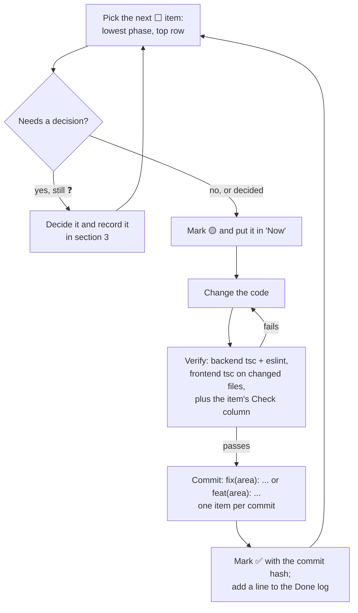

# Fix Plan and Tracker

This is the living list of what we are fixing, in order: what is done, what is in progress, and what needs a decision first. Update it in the same commit as each fix.

- The details behind each issue are in [roles-products-stock.md](roles-products-stock.md) and [hard-coded-values.md](hard-coded-values.md).
- Older review findings are in [review/](review/README.md).
- Last updated: **2026-11-12**.

**Status key**

| Mark | Meaning |
|---|---|
| ⬜ | To do |
| 🟡 | In progress |
| ✅ | Done |
| 🟠 | Partly done |
| ❓ | Waiting for a decision |
| ⛔ | Blocked |
| ➖ | Won't do |

---

## 1. Now

| | |
|---|---|
| **Doing now** | Nothing. Waiting for you to pick the first item. |
| **Your work in progress (W-01)** | POS bill types (B2C/B2B tax invoice, retail invoice), buyer GSTIN, salesman on the bill, payment reference, printed sales invoice (`salesBillInvoice.ts`). Uncommitted. Changes `schema.prisma`, `bill.service.ts`, `bill.validation.ts`, `NewBillPOSPage.tsx`, `BillDetailsModal.tsx`. **Commit it before P0-05 and Phase 4**, which touch the same files. |
| **Next up** | P0-01 → P0-04, P0-06, P0-07 (no decisions needed, no overlap with W-01) |

---

## 2. How we work (the flow)

**Rules**
1. **One item per commit.** The commit message names the item, e.g. `fix(pos): no default PIN (P0-01)`.
2. **Decide first.** An item marked ❓ is not started until its decision in §3 is ✅.
3. **New problems go to the Inbox (§6).** They are not fixed inside another item's commit.
4. **Split big items.** If an item grows, split it (P1-02a, P1-02b) and mark each one separately.
5. **Commits.** Split by feat/fix, with no Co-Authored-By lines (decision D-D). Push only when asked.

---

## 3. Decisions

### Open: needed before the linked items can start

| ID | Question | Options (★ = recommended) | Blocks | Status |
|---|---|---|---|---|
| D-01 | Who creates products? | ★ a) Only shops; the company admin uses shop mode. Remove "Add product" from the company and branch panels. · b) Keep company and branch create, with a required shop picker | P3-01 | ❓ |
| D-02 | Who owns categories, sizes and colours? | ★ a) The company panel; shops pick from them. · b) Keep editing in shops, labelled "shared with all shops" | P3-02 | ❓ |
| D-03 | Who handles online orders? | ★ a) The selling shop; the branch and company only view. · b) Keep every level able to change them | P3-03 | ❓ |
| D-04 | Opening stock on a new product | ★ a) Remove the fake "Stock Quantity" field; stock comes in through a purchase bill. · b) Add "Opening stock" that records a real stock movement | P1-01, I-03 | ❓ |
| D-05 | GST slabs and the clothing rule (5% up to ₹2,500 a piece, 18% above, no 12% slab since 22 Sep 2025?) | Confirm with your CA | P4-01, P4-02 | ❓ |
| D-06 | Status of a product copied into a shop by a stock transfer | ★ a) DRAFT; the shop publishes it. · b) Keep PUBLISHED | P1-06 | ❓ |
| D-07 | Demo company on shared environments | ★ a) Remove it everywhere except local dev (`npm run seed:demo -- --remove`). · b) Keep it | P0-13 | ❓ |
| D-08 | Who may use the shop API (`/shop-admin`)? | ★ a) Only shop admins and the company admin in shop mode. · b) Also branch admins, read-only | P2-01 | ❓ |
| D-09 | When does an unpaid online order expire? | ★ 30 minutes · other | P5-02 | ❓ |
| D-10 | Barcode format | ★ Code128 with `jsbarcode` · EAN-13 (needs registered codes) | P5-06 | ❓ |
| D-11 | Online refunds | ★ a) Refund through the Razorpay API. · b) Refund by hand and record it (P0-03 fixes the wording now) | P5-01 | ❓ |
| D-12 | Time zone | ★ `TZ=Asia/Kolkata` on the server (all shops are in India) · a time zone per company | P0-08 | ❓ |
| D-13 | Branch "Products & Prices" page | ★ a) View only. · b) Bulk tool that lists which shops it changes | P3-04 | ❓ |
| D-14 | Hidden character at the start of commit ae168b8's message | ★ a) Leave it (cosmetic). · b) Force-push to remove it | O-01 | ❓ |
| D-15 | Commit Prisma migrations to git? | ★ a) Yes, so every server gets the same database. · b) Keep them ignored (current; W-01 also ignores them at the repo root) | O-02 | ❓ |
| D-16 | Who may delete a confirmed sales bill? | ★ a) Shop admin or owner only. · b) An employee, with branch approval | P2-03 | ❓ |

### Decided

| ID | Decision | Date | Where |
|---|---|---|---|
| D-A | A company admin runs a shop in "shop mode": the shop is picked per browser tab, sent as `X-Shop-Id`, and they act as that shop's admin | 2026-11-10 | 340d795 |
| D-B | A company with no branches gets an automatic "Main Branch" from the company address | 2026-11-10 | 44748d8 |
| D-C | Refunds the owner takes are approved at once; the owner approves staff refunds | 2026-11-10 | 340d795 |
| D-D | Commits are split by feat/fix, with no Co-Authored-By lines | 2026-11-09 | – |
| D-E | AI photos: up to 3 Cloudflare accounts, tried in order when one is used up or fails | 2026-11-09 | 0609205 |

---

## 4. Issues, one by one

### Phase 0: quick and safe (no decision needed, small changes)

| ID | Problem | Fix | Where | Check | Needs | Status |
|---|---|---|---|---|---|---|
| P0-01 | Users without a PIN get PIN 1234 when they save their profile | Empty by default; send only when typed | `frontend/src/pages/profile/MyProfilePage.tsx:30, 87` | Save the profile without a PIN; the DB PIN is unchanged | – | ⬜ |
| P0-02 | Barcode labels print "MATOSHRI FASHIONS" | Use the logged-in shop's name | `frontend/src/pages/shop/barcode/BarcodeLabelsPage.tsx:361, 811` | Print preview shows your shop | – | ⬜ |
| P0-03 | Customer is told "₹X has been refunded" when no refund was made | Change the text to "Refund approved; you'll get it within N days" | `backend/src/services/order.service.ts:578-585, 651, 863` | Set an order to REFUNDED; read the notification | – | ⬜ |
| P0-04 | Debit note defaults to the fake supplier "Tiruppur Knits - 33" and a fake bill | Start empty; set from the loaded suppliers; remove the fake options | `frontend/src/pages/shop/returns/PurchaseReturnPage.tsx:37, 250, 272` | Save a debit note; the supplier is the real one | – | ⬜ |
| P0-05 | Every new POS bill shows "…/26-27/00232" | Show "New bill" or the real next number | `frontend/src/pages/shop/pos/NewBillPOSPage.tsx:738` | Open the POS | W-01 | ⛔ |
| P0-06 | CORS lets any website call the API | Use `config.cors.origins`; set `CORS_ORIGINS` for both frontends | `backend/src/app.ts:36`, `backend/.env` | Panel and store still work; another origin is refused | – | ⬜ |
| P0-07 | Public test page with a dev-tunnel URL | Delete the file | `backend/public/backup-test.html` | `/backup-test.html` returns 404 | – | ⬜ |
| P0-08 | Bills between 00:00 and 05:29 IST can get yesterday's date | `TZ=Asia/Kolkata` in the backend env and `.env.example` | `backend/.env`, `.env.example` | Bill created after midnight IST has today's date | D-12 | ❓ |
| P0-09 | My Profile shows the company admin as "Branch Manager"; the header "My Profile" link gives "Access denied" for the company admin, super admin and employees | Use the `ROLES` labels; profile path per panel | `MyProfilePage.tsx:39-46`, `Header/DropdownUser.tsx:31-34` | Open My Profile as each role | – | ⬜ |
| P0-10 | Debit note adds 5% GST to 0% items | `??` instead of `\|\|`; take the rate from the purchase bill line | `backend/src/services/purchaseReturn.service.ts:129, 203, 265`, `validations/purchaseReturn.validation.ts:14` | Return a 0% item; tax is 0 | – | ⬜ |
| P0-11 | Fake number series: debit notes start at 0004, receipts at 0044 | Use `accountService.nextCode` with no offset | `purchaseReturn.service.ts:46`, `credit.service.ts:59` | First new number is 0001 in a fresh FY | – | ⬜ |
| P0-12 | Credit/Udhaar page: fake totals, picks "Kavita", ₹2,000 default, `RC/26-27/0044` | `?? 0` / "—"; first customer; empty amount | `frontend/src/pages/shop/credit/CreditUdhaarPage.tsx`, `lib/api/credit.ts:35` | Page with no customers shows zeros | – | ⬜ |
| P0-13 | Demo company's products show on the store | Run `npm run seed:demo -- --remove` on shared environments | (ops step) | The store shows only real shops | D-07 | ❓ |

### Phase 1: wrong numbers and wrong products online

| ID | Problem | Fix | Where | Check | Needs | Status |
|---|---|---|---|---|---|---|
| P1-01 | Shop product "Stock Quantity" is fake; the panel and the store disagree | Remove the field from the form and the API; show real stock from `Inventory` | `shopProduct.validation.ts:64`, `shopProduct.service.ts`, `shopProductSchema.ts:39`, `ShopProductForm.tsx`, `ShopProductList.tsx:151-154`, `ShopProductDetail.tsx` | New product shows 0 until a purchase bill; then the panel, POS and store match | D-04 | ❓ |
| P1-02 | Stock page shows hard-coded totals, rows, costs and "This month (1-3 Nov)"; the date filter does nothing; lists every company product | Compute from `Inventory` and movements; filter by date; only the shop's own items | `backend/src/services/stock.service.ts`, `frontend/src/pages/shop/stock/StockPage.tsx` | Totals match a manual sum; another shop's items are not listed | – | ⬜ |
| P1-03 | Stock Adjustment: fake ADJ-0046 numbering, ids clash between branches, no transaction, fake "before" counts | `nextCode`; unique id; one transaction through `applyStockChanges`; no fallbacks | `stockAdjustment.service.ts`, `StockAdjustmentPage.tsx`, `lib/api/stockAdjustment.ts:18` | Two branches can each make an adjustment | – | ⬜ |
| P1-04 | Store shows products of switched-off branches; wishlist and bag check less than the listing | One shared `LISTED` rule with the branch check, used for listing, detail, cart add, bag line and wishlist | `store/catalog.service.ts:56-61`, `store/customer.service.ts:93, 221-239, 341, 350` | Deactivate a branch: its products disappear and can't be ordered | – | ⬜ |
| P1-05 | Renaming a product breaks its link | Keep the slug from creation | `shopProduct.service.ts:348`, `product.service.ts:226` | Rename; the old URL still opens | – | ⬜ |
| P1-06 | Received transfers create published copies online | Create the copy as DRAFT | `stockTransfer.service.ts:526-544` | Receive a new item; it isn't on the store until published | D-06 | ❓ |
| P1-07 | A shop can change another shop's stock in the same company (other companies were blocked in 7caed27) | Only allow `product.shopId = own shop` in all 3 adjust paths | `inventory.service.ts:225-230`, `stock.service.ts:366-369`, `stockAdjustment.service.ts:212-214` | Adjusting shop B's variant from shop A → 403 | – | 🟠 |
| P1-08 | Suppliers page: picks "Tiruppur", `PY/26-27/0019`, fixed statement period | Remove; use real data and dates | `frontend/src/pages/shop/suppliers/SuppliersPage.tsx:82-96`, `lib/api/supplier.ts:32` | Page with no suppliers shows an empty state | – | ⬜ |
| P1-09 | Debit note prefilled note, quantities and reason ("Ivory"), ₹18,900, `DN/26-27/0006` | Delete the prefills and fallbacks | `PurchaseReturnPage.tsx:46, 86-97, 144, 223`, `lib/api/purchaseReturn.ts:18` | Form starts empty | – | ⬜ |
| P1-10 | Open store tabs show sold-out or unpublished items; out-of-stock items lead "New arrivals" | Refetch on focus for home, listing and search; in-stock first in two queries | `user/src/main.tsx:11`, `user/src/lib/queries.ts`, `store/catalog.service.ts:502, 527` | Unpublish, return to the tab: the item is gone | – | ⬜ |
| P1-11 | Profile photo and expense bill save only the file name | Upload through the existing file endpoint | `MyProfilePage.tsx:88`, `ShopExpensesPage.tsx:109` | The photo shows after reload | – | ⬜ |
| P1-12 | Barcode page: picks bill "0042"; prints the sample "Cotton Kurta Indigo" when empty | Empty state instead | `BarcodeLabelsPage.tsx:110-115, 219-232` | No bills → nothing to print | – | ⬜ |

### Phase 2: security and who-sees-what

| ID | Problem | Fix | Where | Check | Needs | Status |
|---|---|---|---|---|---|---|
| P2-01 | `/shop-admin` also accepts the super admin (sees and changes all orders, all employees, any stock) and the branch admin (edits company masters) | Allow only shop admins and the company admin in shop mode; first check branch pages that call it | `backend/src/routes/shopAdmin.routes.ts:178` | Super admin token on `/shop-admin/orders` → 403 | D-08 | ❓ |
| P2-02 | A shop sees other shops' suppliers and purchase bills, barcode-label bills and Stock page items | Filter by `shopId` | `supplier.service.ts:39-45, 272-279`, `barcodeLabel.service.ts:23-26, 109-110`, `stock.service.ts:145` | Shop A can't see shop B's bills | – | ⬜ |
| P2-03 | An employee with billing edit can delete a confirmed bill without approval | Per D-16 | `bill.routes.ts:20`, `bill.service.ts:1036-1054` | Employee delete → 403 (or approval) | D-16 | ❓ |
| P2-04 | Branch product edit rights follow the creator's current branch | Use the product's shop's branch | `product.service.ts:22, 58` | Move an employee; product rights stay | – | ⬜ |
| P2-05 | `HOSTED_BACKEND_URL` silently defaults to an external upload server | Add to the config schema, no default | `backend/src/utils/s3upload.ts:5`, `config/config.ts` | Unset → clear error at startup | – | ⬜ |
| P2-06 | `posPin` returned in user data and not hashed; password rules; `/refresh` rate limit; refresh tokens not hashed (older review) | Hash and stop returning the PIN; rules; limit; hash tokens | `user.service.ts:42`, `auth.*` | See `review/06-authn-payments-audit.md` | – | ⬜ |
| P2-07 | `mustChangePassword` is never enforced in the admin app (older review) | Send to a change-password page after login | `frontend` auth flow | First login forces a change | – | ⬜ |
| P2-08 | XSS cleaning is off (TODO) | Turn it on, or remove it and rely on output escaping | `backend/src/app.ts:28-29` | – | – | ⬜ |
| P2-09 | 20 controllers write without an audit entry; Main Branch creation not audited | Add `auditService.track` | orders, stock, promotions, suppliers, pricing, expenses, credit limit, branch | Each write shows in the audit table | – | ⬜ |
| P2-10 | Admin panel falls back to `localhost:5692` when `VITE_SERVER_URL` is missing | Fail the build | `frontend/src/utils/axios.ts:8, 12` | Build without the variable fails | – | ⬜ |

### Phase 3: make roles and stock clear

| ID | Problem | Fix | Where | Check | Needs | Status |
|---|---|---|---|---|---|---|
| P3-01 | Company and branch create products that can never be sold | Per D-01; show existing ones as "Not in any shop" | `product.service.ts:150-205`, company and branch product pages, `Sidebar:177` | No unsellable product can be created | D-01 | ❓ |
| P3-02 | Categories, sizes and colours are edited in a shop but apply company-wide | Per D-02 | `master.service.ts:20-27`, `shopAdmin.routes.ts:45-59`, menus | A shop can't rename "XL" for everyone | D-02 | ❓ |
| P3-03 | Online orders can be changed at four levels | Per D-03 | order routes in the company, branch and shop routers | Only the owner level sees action buttons | D-03 | ❓ |
| P3-04 | Prices set in three places | Shop only; branch page per D-13 | `branchPricing.service.ts`, `product.service.ts` | – | D-13 | ❓ |
| P3-05 | Three stock-adjust code paths | Merge into one path through `applyStockChanges` | `inventory.service.ts`, `stock.service.ts`, `stockAdjustment.service.ts` | Concurrent sale + adjust: no lost update | P1-03, P1-07 | ⬜ |
| P3-06 | The company admin can't approve stock transfers; Main Branch requests get stuck | Owner approves when there is no branch admin (shop mode, like refunds) | `stockTransfer.service.ts`, `shopAdmin.routes.ts`, transfer page | Request in Main Branch → owner approves | – | ⬜ |
| P3-07 | Menu text promises missing features; branch "Purchase Return" always fails; pages with no menu entry | Fix the wording; hide or route correctly | `Sidebar/index.tsx:218, 237, 289, 309, 521`, `PurchaseReturnPage.tsx:24` | Every menu item opens and works | – | ⬜ |
| P3-08 | Four staff-onboarding paths; the branch invite shows 10 modules but saves 6 | One path; one module list | `staff.service.ts:224`, `config/permissions.ts:124-131`, `BranchStaffPage.tsx:15` | Ticked modules are saved | – | ⬜ |
| P3-09 | Two branch refund-approval endpoints, one not audited | Keep the audited one | `branchAdmin.routes.ts:134, 159` | – | – | ⬜ |
| P3-10 | Renaming a size or colour, then saving a product, switches off variants and their stock | Match variants by master id, not name | `shopProduct.service.ts:215-248` | Rename "XL"; stock stays | – | ⬜ |

### Phase 4: tax, documents and settings

| ID | Problem | Fix | Where | Check | Needs | Status |
|---|---|---|---|---|---|---|
| P4-01 | GST slab lists are 0/5/12/18 | Per the CA's answer, one slab list | validations, product forms, `BillFormModal.tsx:42` | – | D-05, W-01 | ❓ |
| P4-02 | The POS sends the GST rate and the server trusts it | Server takes the product's rate (and the price rule) | `bill.service.ts:338, 431`, `bill.validation.ts:25`, `NewBillPOSPage.tsx:295` | Tamper the rate in the request → ignored | D-05, W-01 | ❓ |
| P4-03 | GST maths copied in 4+ places; IGST chosen by state name | Backend returns the GST breakup by state code; UIs print it | POS, `BillFormModal`, `salesBillInvoice.ts`, `user/src/routes/invoice.$id.tsx` | Screen, receipt and invoice match to the paisa | W-01 | ⬜ |
| P4-04 | HSN missing on products; fallbacks 6206 and 6204 | Add HSN to the product (migration); require it | `schema.prisma`, product forms, `purchaseReturn.service.ts:116`, `NewBillPOSPage.tsx:285` | Debit note and bill show the product's HSN | D-15 | ⬜ |
| P4-05 | Financial-year helper copied 4 times; `AUD-26-27` typed in | One helper | `bill.service.ts:74`, `expense.service.ts:20`, `credit.service.ts:39`, `purchaseReturn.service.ts:26`, `stock.service.ts:464` | – | – | ⬜ |
| P4-06 | Bill numbers can exceed 16 characters (GST limit, verify) | Limit the prefix; configurable series | `bill.service.ts:166`, `org.validation.ts:119` | – | – | ⬜ |
| P4-07 | Online-order invoice: no seller GSTIN or HSN, two invoice numbers, fake tagline | Backend issues one number; print GSTIN, HSN and breakup | `frontend/src/utils/invoiceGenerator.ts`, `user/src/routes/invoice.$id.tsx` | Same number in the panel and the store | – | ⬜ |
| P4-08 | Business rules fixed in code: refund limit ₹2,000, 10% discount, low stock 5/3, delivery ₹49/₹999/₹99, ETAs, 7-day returns, credit days 15, margin 25%, shift times | One company-settings record; UIs read it | see `hard-coded-values.md` §3 | Change a setting → screens follow | D-15 | ⬜ |
| P4-09 | Store address form has 22 of 36 states; one size chart for all; menu categories exist only in demo data | Full state list; size chart per category or hidden; menu from real categories | `user/src/components/AddressForm.tsx`, `product.$id.tsx:15-22`, `index.tsx:37`, `Layout.tsx:16-18` | A Ladakh address saves | – | ⬜ |
| P4-10 | "Cloth Pro" printed on invoices and WhatsApp; page title typo | App name setting; documents use the shop name | see `hard-coded-values.md` §4 | – | – | ⬜ |
| P4-11 | Row caps hide data (2,000 products, 50 orders, exports 5,000/1,000, …) | Paginate or warn | see `hard-coded-values.md` §3 | – | – | ⬜ |

### Phase 5: online orders, money and stock accuracy

| ID | Problem | Fix | Where | Needs | Status |
|---|---|---|---|---|---|
| P5-01 | No real online refunds | Per D-11 | `order.service.ts` | D-11 | ❓ |
| P5-02 | Unpaid online orders hold stock forever | Job that cancels and restocks after the expiry time | `store/checkout.service.ts`, `order.service.ts:355-386` | D-09 | ❓ |
| P5-03 | Cancel after dispatch restocks goods at the courier; exchanges never take the new size out of stock | Block restock after dispatch; post SALE_OUT for the exchange | `order.service.ts:595-622, 794, 862` | – | ⬜ |
| P5-04 | Purchase return: "take stock from" ignored, no movement, shop id saved as branch id, bill can be cancelled after a debit note | Route through `applyStockChanges`; fix branch; block cancel | `purchaseReturn.service.ts:237-291`, `bill.service.ts:608-716` | – | ⬜ |
| P5-05 | Damaged returns and transfer shortages vanish from all counts | Record `damagedQty` and a movement | `creditNote.service.ts:302`, `stockTransfer.service.ts:619` | – | ⬜ |
| P5-06 | Barcode bars are decorative and won't scan | Real barcodes | `BarcodeLabelsPage.tsx:46-74, 370-378` | D-10 | ❓ |
| P5-07 | Delivery estimate is the same for every pincode; COD always yes | Courier data, or say "usually" | `store/catalog.service.ts:537-553`, `store/orders.service.ts:161` | – | ⬜ |
| P5-08 | Day close has no cash count; bills can be changed after close (older review) | Cash count; lock closed days | day close and bill services | – | ⬜ |
| P5-09 | Money stored as Float; no double-submit guard on bills (older review) | Decimal; idempotency key | `schema.prisma`, POS | D-15 | ⬜ |

### Phase 6: clean-up and health

| ID | Problem | Fix | Status |
|---|---|---|---|
| P6-01 | 190 catering-app files and dead pages (`BranchSuppliersPage`, `BranchDashboard`, `ComingSoon`, `BranchProfile`, `Calendar`, `ExpiryPopup`, `ModalComponent`, `TabularContent`) | Delete; check with a build | ⬜ |
| P6-02 | Unused permissions; leftover constants (`s3constants.ts`, `constants.ts`, `link-to-app`); fake actor ids (`'user-admin'`, `'admin'`, `'system'`) | Delete or use `req.user.id` | ⬜ |
| P6-03 | `package.json` name "restaurant", broken `prisma:db:seed`; swagger empty in builds and public | Fix or turn off in production | ⬜ |
| P6-04 | No tests or CI | Tests for billing, stock and credit first; CI runs tsc, lint and tests | ⬜ |

### Older open items

| ID | Item | Needs | Status |
|---|---|---|---|
| O-01 | Hidden character at the start of commit ae168b8's message | D-14 | ❓ |
| O-02 | Prisma migrations are not in git | D-15 | ❓ |

---

## 5. Improvements (new features)

| ID | Improvement | Why | Needs | Status |
|---|---|---|---|---|
| I-01 | Company sales and P&L report | The owner has only counts today | – | ⬜ |
| I-02 | Audit log page | Audit rows are written but nobody can read them | P2-09 | ⬜ |
| I-03 | Opening stock when adding a product | Faster set-up for a new shop | D-04 = b | ❓ |
| I-04 | Company settings page | Owners change limits, fees and number series themselves | P4-08 | ⬜ |
| I-05 | Owner approvals inbox (refunds and transfers in one place) | Small businesses with no branch admin | P3-06 | ⬜ |
| I-06 | Courier tracking and real delivery dates | Honest delivery promises | P5-07 | ⬜ |

More ideas: GST exports, loyalty, WhatsApp, offline POS. See [review/04-feature-roadmap.md](review/04-feature-roadmap.md).

---

## 6. Inbox (new problems, not yet sorted)

Add new findings here with ⬜. Sort them into a phase when the next item is picked.

| Found | Problem | Where | Status |
|---|---|---|---|
| | | | |

---

## 7. Done log

| Date | What | Commit |
|---|---|---|
| 2026-11-12 | Docs: who manages what, products and stock, hard-coded values, this plan | (not committed) |
| 2026-11-10 | Refuse "any shop" stock requests when the branch has no other shop | ef34cbf |
| 2026-11-10 | Automatic Main Branch for businesses without branches | 44748d8 |
| 2026-11-10 | Shop mode: company admin sells in and manages their own shops; owner approves refunds | 340d795 |
| 2026-11-09 | Third Cloudflare AI account as a backup | 0609205 |
| 2026-11-09 | AI photos retry once on a Cloudflare server error | ae168b8 |
| 2026-11-08 | Ignore `user/.env`; refresh the store lockfile | 91f7d44 |
| 2026-11-08 | Project docs, issue review, security audit | 1db6fda |
| 2026-11-08 | Employee home links to online orders and subcategories | bbd35a6 |
| 2026-11-08 | `seed:org` sets up the super admin, company and branches from JSON | 3071977 |
| 2026-11-08 | AI photo tools for company admins; full-size photo viewer | 45dbbf9 |
| 2026-11-08 | AI enhance style, better prompts, model poses, second AI account | 758e763 |
| 2026-11-08 | Optional subcategory, standard sizes and colours, form help | 87dbd57 |
| 2026-11-08 | Store: similar products no longer match every product | 1c0e1f9 |
| 2026-11-08 | Security: login limits, legacy checkout removed, stock changes limited to own company, demo seed blocked in production, label text escaped | 7caed27 |
